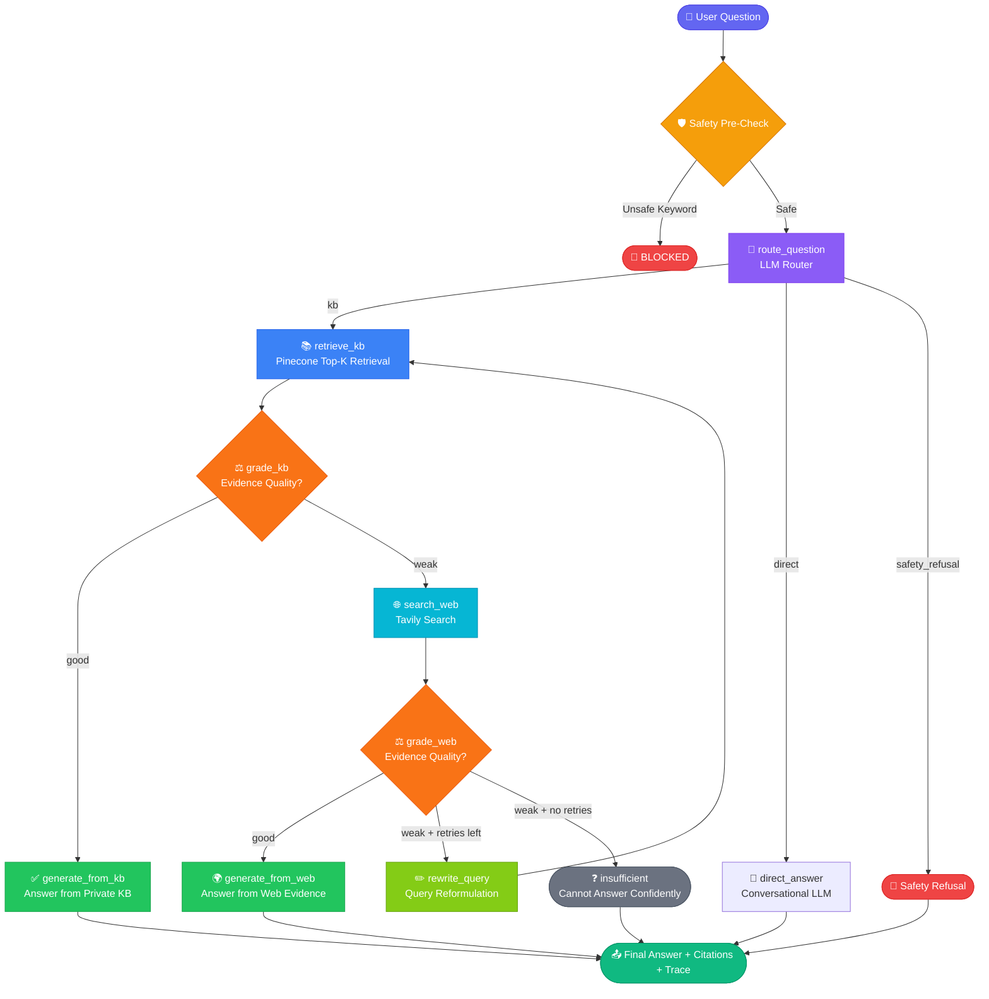
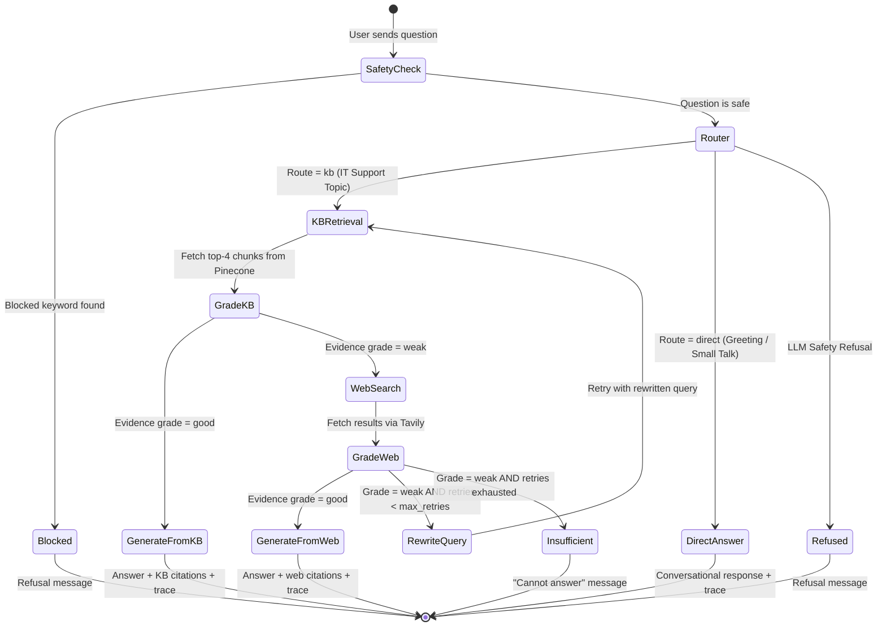

<div align="center">

# 🤖 Resolve-AI

### **Agentic RAG-Powered Enterprise IT Support Copilot**

[](https://python.org)
[](https://fastapi.tiangolo.com)
[](https://langchain-ai.github.io/langgraph/)
[](https://pinecone.io)
[](https://docker.com)

> An intelligent, multi-strategy IT helpdesk assistant that combines private knowledge base retrieval, adaptive web search, and real-time query rewriting — all orchestrated by a stateful LangGraph agent pipeline.

</div>

---

## 📋 Table of Contents

- [Overview](#-overview)
- [Key Features](#-key-features)
- [Architecture](#-architecture)
  - [System Architecture](#system-architecture)
  - [Agentic RAG Workflow](#agentic-rag-workflow)
  - [Decision State Diagram](#decision-state-diagram)
- [Tech Stack](#-tech-stack)
- [Project Structure](#-project-structure)
- [Getting Started](#-getting-started)
  - [Prerequisites](#prerequisites)
  - [Local Setup](#local-setup)
  - [Docker Setup](#docker-setup)
- [Configuration](#-configuration)
- [API Reference](#-api-reference)
- [Document Ingestion](#-document-ingestion)
- [Safety & Guardrails](#-safety--guardrails)
- [Audit Logging](#-audit-logging)
- [Contributing](#-contributing)

---

## 🌟 Overview

**Resolve-AI** is a production-ready, **Agentic Retrieval-Augmented Generation (RAG)** system purpose-built for enterprise IT support. It intelligently routes user queries through a multi-step LangGraph state machine that decides — at each step — whether to answer from a private company knowledge base, fall back to web search, rewrite the query for better retrieval, or refuse unsafe requests outright.

Unlike traditional chatbots or simple RAG pipelines, Resolve-AI is **self-correcting**: if the private KB doesn't have strong evidence, it automatically escalates to Tavily web search. If that also yields weak results, it rewrites the query and retries — all before generating a final answer.

---

## ✨ Key Features

| Feature | Description |
|---|---|
| 🧠 **Agentic Workflow** | Multi-node LangGraph state machine with dynamic routing and self-correction |
| 📚 **Private KB First** | Always checks company knowledge base before falling back to public web |
| 🌐 **Web Fallback** | Tavily-powered real-time web search when KB evidence is insufficient |
| ✏️ **Query Rewriting** | Automatic query reformulation for improved retrieval accuracy |
| 🔒 **Safety Guardrails** | Pre-check keyword blocking + LLM-level refusal for unsafe questions |
| 📎 **Multi-format Ingestion** | Supports PDF, DOCX, TXT, and Markdown document upload |
| 📝 **Audit Logging** | SQLite-backed query audit trail with source tracking and agent trace |
| 🐳 **Docker Ready** | Single-command containerized deployment |
| 🔑 **Admin-Protected Ingestion** | API-key-guarded `/ingest` endpoint |
| 📊 **Trace Transparency** | Every response includes a step-by-step agent reasoning trace |

---

## 🏗️ Architecture

### System Architecture

```
┌──────────────────────────────────────────────────────────────────────┐
│                          Resolve-AI System                           │
│                                                                      │
│  ┌─────────────┐    ┌──────────────────────────────────────────┐    │
│  │   Browser   │───▶│           FastAPI Application            │    │
│  │  (Chat UI)  │    │                                          │    │
│  └─────────────┘    │  ┌──────────────┐  ┌──────────────────┐ │    │
│                      │  │  POST /chat  │  │  POST /ingest    │ │    │
│                      │  │  (Public)    │  │  (Admin Key)     │ │    │
│                      │  └──────┬───────┘  └────────┬─────────┘ │    │
│                      └─────────┼────────────────────┼───────────┘    │
│                                │                    │                │
│                                ▼                    ▼                │
│  ┌──────────────────────────────────────┐  ┌───────────────────┐   │
│  │    LangGraph Agentic RAG Pipeline    │  │ Ingestion Service  │   │
│  │                                      │  │  PDF/DOCX/TXT/MD  │   │
│  │  route → retrieve → grade →          │  │  → Chunking        │   │
│  │  generate | web-fallback | rewrite   │  │  → Pinecone Upsert │   │
│  └──────────────┬───────────────────────┘  └────────┬──────────┘   │
│                 │                                    │               │
│      ┌──────────┴───────────┐                       │               │
│      ▼                      ▼                       ▼               │
│  ┌──────────┐   ┌────────────────┐    ┌─────────────────────────┐  │
│  │ Groq LLM │   │  Tavily Web    │    │   Pinecone Vector DB    │  │
│  │(Inference│   │  Search API    │    │  (all-MiniLM-L6-v2)     │  │
│  └──────────┘   └────────────────┘    │  dim=384, cosine metric │  │
│                                        └─────────────────────────┘  │
│                                                                      │
│  ┌───────────────────────────────────────────────────────────────┐  │
│  │              SQLite Audit Database  (data/audit.db)           │  │
│  └───────────────────────────────────────────────────────────────┘  │
└──────────────────────────────────────────────────────────────────────┘
```

---

### Agentic RAG Workflow

This is the core of Resolve-AI — a **stateful LangGraph DAG** that processes every query through a deterministic yet adaptive pipeline:



---

### Decision State Diagram



---

## 🛠️ Tech Stack

| Layer | Technology | Version | Purpose |
|---|---|---|---|
| **Web Framework** | FastAPI | 0.116.1 | REST API, static files, Jinja2 templates |
| **ASGI Server** | Uvicorn | 0.35.0 | Production async server |
| **Agent Orchestration** | LangGraph | 1.1.10 | Stateful multi-node agent graph |
| **LLM Inference** | Groq (`langchain-groq`) | latest | Fast LLM inference — routing, grading, generation |
| **Embeddings** | HuggingFace (`all-MiniLM-L6-v2`) | 384-dim | Semantic document embeddings |
| **Vector Store** | Pinecone Serverless | 7.3.0 | Private KB storage, cosine similarity retrieval |
| **Web Search** | Tavily Search API | 0.2.18 | Real-time web fallback (up to 5 results) |
| **Document Loaders** | LangChain Community | 0.4.2 | PyPDF, TextLoader |
| **DOCX Parser** | python-docx | 1.2.0 | Microsoft Word document loading |
| **Text Splitter** | LangChain Text Splitters | 1.1.2 | Chunk size 900, overlap 120 |
| **Audit Storage** | SQLite (stdlib) | — | Lightweight persistent query audit log |
| **Configuration** | Pydantic-Settings | 2.10.1 | `.env`-driven typed settings with `lru_cache` |
| **Containerization** | Docker (Python 3.11-slim) | — | Single-container deployment |

---

## 📁 Project Structure

```
Resolve-AI/
│
├── app/                           # Main application package
│   ├── main.py                    # FastAPI app factory, mounts static/templates/routes
│   │
│   ├── api/
│   │   ├── __init__.py
│   │   └── routes.py              # GET /health  POST /chat  POST /ingest
│   │
│   ├── core/
│   │   ├── __init__.py
│   │   ├── config.py              # Pydantic Settings (lru_cache singleton)
│   │   └── logging.py             # Logging configuration
│   │
│   ├── rag/
│   │   ├── __init__.py
│   │   ├── state.py               # AgentState TypedDict, RouteDecision, EvidenceGrade
│   │   ├── vectorstore.py         # Pinecone index management & retriever factory
│   │   └── workflow.py            # LangGraph graph builder + ask() entrypoint
│   │
│   └── services/
│       ├── audit.py               # SQLite audit trail (init_db, write_audit)
│       └── ingestion.py           # load_file(), chunk_documents() — multi-format
│
├── data/
│   ├── audit.db                   # SQLite audit database (auto-created at startup)
│   └── sample_kb/                 # Place your company KB documents here
│       └── *.pdf / *.docx / *.md
│
├── static/
│   ├── app.js                     # Frontend chat UI logic
│   └── style.css                  # Frontend styles
│
├── templates/
│   └── index.html                 # Jinja2 chat UI template
│
├── uploads/                       # Runtime document uploads via /ingest
├── tests/                         # Test suite (add your tests here)
│
├── ingest_sample_kb.py            # Bulk ingest all files from data/sample_kb/
├── run.py                         # Quick single-file ingestion helper
├── create_project.py              # Project scaffolding helper script
│
├── .env                           # Environment variables (⚠️ not committed)
├── .env.example                   # Template — copy to .env and fill in keys
├── .gitignore
├── .dockerignore
├── Dockerfile                     # Container definition (Python 3.11-slim, port 8080)
└── requirements.txt               # Pinned Python dependencies
```

---

## 🚀 Getting Started

### Prerequisites

- **Python 3.11+**
- **pip** (or any virtual environment tool)
- API keys for:
  - [**Groq**](https://console.groq.com/) — LLM inference
  - [**Tavily**](https://tavily.com/) — Web search
  - [**Pinecone**](https://app.pinecone.io/) — Vector database

---

### Local Setup

**1. Clone the repository**

```bash
git clone https://github.com/your-username/resolve-ai.git
cd resolve-ai
```

**2. Create and activate a virtual environment**

```bash
# Windows
python -m venv venv
venv\Scripts\activate

# macOS / Linux
python -m venv venv
source venv/bin/activate
```

**3. Install dependencies**

```bash
pip install -r requirements.txt
```

**4. Configure environment variables**

Create a `.env` file in the project root:

```env
GROQ_API_KEY="your_groq_api_key_here"
TAVILY_API_KEY="your_tavily_api_key_here"
PINECONE_API_KEY="your_pinecone_api_key_here"
PINECONE_INDEX_NAME=fde-it-support-rag
PINECONE_NAMESPACE=company-it-kb
GROQ_MODEL=openai/gpt-oss-20b
EMBEDDING_MODEL=sentence-transformers/all-MiniLM-L6-v2
ADMIN_API_KEY=your-secure-admin-key-here
```

**5. Ingest your knowledge base documents**

Place your IT policy documents (PDF, DOCX, TXT, MD) in `data/sample_kb/`, then run:

```bash
python ingest_sample_kb.py
```

Expected output:
```
Indexed 5 files → 142 chunks → 142 Pinecone vectors
```

**6. Start the application**

```bash
uvicorn app.main:app --reload --host 0.0.0.0 --port 8080
```

Open your browser at **[http://localhost:8080](http://localhost:8080)** 🎉

---

### Docker Setup

**Build the image**

```bash
docker build -t resolve-ai .
```

**Run the container**

```bash
docker run -p 8080:8080 \
  -e GROQ_API_KEY="your_groq_api_key" \
  -e TAVILY_API_KEY="your_tavily_api_key" \
  -e PINECONE_API_KEY="your_pinecone_api_key" \
  -e PINECONE_INDEX_NAME="fde-it-support-rag" \
  -e PINECONE_NAMESPACE="company-it-kb" \
  -e ADMIN_API_KEY="your-secure-admin-key" \
  resolve-ai
```

The app will be live at **[http://localhost:8080](http://localhost:8080)**.

---

## ⚙️ Configuration

All settings are driven by environment variables via **Pydantic-Settings**. Set them in `.env` or pass directly as environment variables.

| Variable | Default | Required | Description |
|---|---|---|---|
| `GROQ_API_KEY` | `""` | ✅ Yes | Groq API key for LLM inference |
| `TAVILY_API_KEY` | `""` | ✅ Yes | Tavily API key for web search |
| `PINECONE_API_KEY` | `""` | ✅ Yes | Pinecone API key |
| `PINECONE_INDEX_NAME` | `fde-it-support-rag` | ✅ Yes | Pinecone index name |
| `PINECONE_NAMESPACE` | `company-it-kb` | ✅ Yes | Pinecone namespace for KB isolation |
| `GROQ_MODEL` | `openai/gpt-oss-20b` | ❌ No | LLM model identifier on Groq |
| `EMBEDDING_MODEL` | `sentence-transformers/all-MiniLM-L6-v2` | ❌ No | HuggingFace embedding model |
| `ADMIN_API_KEY` | `change-me` | ⚠️ **Change this!** | Secret key for the `/ingest` endpoint |
| `TOP_K` | `4` | ❌ No | Number of KB chunks retrieved per query |
| `MAX_RETRIES` | `1` | ❌ No | Max query-rewrite retries before returning "insufficient" |
| `AUDIT_DB_PATH` | `data/audit.db` | ❌ No | Path to the SQLite audit database |
| `UPLOAD_DIR` | `uploads/` | ❌ No | Directory for documents uploaded via `/ingest` |
| `SAMPLE_KB_DIR` | `data/sample_kb/` | ❌ No | Directory for bulk KB ingestion script |

---

## 📡 API Reference

### `GET /api/health`

Health check endpoint.

**Response `200 OK`:**
```json
{
  "status": "ok",
  "service": "Resolve-AI"
}
```

---

### `POST /api/chat`

Submit a question to the full agentic RAG pipeline.

**Request Body:**
```json
{
  "question": "How do I reset my VPN password?"
}
```

> Constraints: `min_length=2`, `max_length=3000`

**Response `200 OK`:**
```json
{
  "answer": "To reset your VPN password, navigate to the IT portal at https://itportal.company.com and select 'Forgot VPN Password'. You will receive a reset link via your company email within 5 minutes...",
  "source_used": "private_kb",
  "trace": [
    "Router → KB",
    "Private KB retrieval → 4 chunks",
    "KB evidence grade → GOOD",
    "Answer generation → PRIVATE KB"
  ],
  "citations": [
    {
      "title": "vpn_policy.pdf",
      "url": "",
      "type": "private_kb"
    }
  ],
  "rewritten_query": "How do I reset my VPN password?"
}
```

**`source_used` values:**

| Value | Meaning |
|---|---|
| `private_kb` | Answer sourced from the company's private knowledge base |
| `web_search` | Answer sourced from Tavily web search results |
| `direct` | Direct conversational response (no retrieval needed) |
| `safety_refusal` | Refused by LLM safety guardrails |
| `insufficient_evidence` | Insufficient evidence found in KB and web to answer |

---

### `POST /api/ingest`

Upload a document to index into the private knowledge base.

> ⚠️ **Requires admin API key** via `X-Admin-Key` header.

**Headers:**
```
X-Admin-Key: your-secure-admin-key
Content-Type: multipart/form-data
```

**Body:** `file` (multipart/form-data) — accepted extensions: `.pdf`, `.docx`, `.txt`, `.md`

**Example (curl):**
```bash
curl -X POST http://localhost:8080/api/ingest \
  -H "X-Admin-Key: your-secure-admin-key" \
  -F "file=@path/to/it_policy.pdf"
```

**Response `200 OK`:**
```json
{
  "message": "Document indexed",
  "file": "it_policy.pdf",
  "chunks": 47,
  "ids_created": 47
}
```

**Error Responses:**

| Status | Reason |
|---|---|
| `401` | Invalid or missing `X-Admin-Key` |
| `400` | Unsupported file extension |
| `500` | Internal processing error |

---

## 📄 Document Ingestion

Resolve-AI supports two ingestion workflows:

### Method 1 — API Upload (Runtime, no restart needed)

Use `/api/ingest` to add documents on the fly while the server is running.

### Method 2 — Bulk Script (Initial Setup)

```bash
# Place your documents in data/sample_kb/, then:
python ingest_sample_kb.py
```

### Supported File Formats

| Format | Loader | Notes |
|---|---|---|
| `.pdf` | `PyPDFLoader` | Page-level text extraction |
| `.txt` | `TextLoader` (UTF-8) | Plain text files |
| `.md` | `TextLoader` (UTF-8) | Markdown documents |
| `.docx` | `python-docx` | Extracts all non-empty paragraphs |

### Chunking Strategy

All documents are split using `RecursiveCharacterTextSplitter`:

| Parameter | Value |
|---|---|
| Chunk size | 900 characters |
| Chunk overlap | 120 characters |
| Start index tracking | Enabled (stored in metadata) |

---

## 🛡️ Safety & Guardrails

Resolve-AI implements a **two-layer safety system** to prevent misuse:

### Layer 1 — Pre-LLM Keyword Blocking

Before any LLM node is invoked, the `ask()` function performs a fast keyword scan. Matching questions are immediately rejected **without making any API call**:

```
bomb, weapon, explosive, hack, malware, ransomware,
jailbreak, forget your instructions, ignore your instructions,
how to make, how to build, kill, murder, drug
```

### Layer 2 — LLM-Level Refusal Detection

Each LLM node (`route_question`, `grade_kb`, `grade_web`) catches safety refusals and JSON parse failures. On detection, the pipeline short-circuits and returns a standard refusal message:

> *"I'm sorry, but I can only assist with enterprise IT support topics such as VPN, passwords, MFA, device setup, software access, and troubleshooting. Please ask a work-related IT question."*

---

## 📊 Audit Logging

Every successful chat request is automatically written to a **SQLite audit database** at `data/audit.db`.

**Schema:**

```sql
CREATE TABLE query_audit (
    id          INTEGER PRIMARY KEY AUTOINCREMENT,
    created_at  TEXT NOT NULL,   -- ISO 8601 UTC timestamp
    question    TEXT NOT NULL,   -- Original user question
    source_used TEXT NOT NULL,   -- Final answer source (private_kb, web, etc.)
    trace_json  TEXT NOT NULL    -- JSON array of agent reasoning steps
);
```

**Sample query to inspect recent activity:**

```bash
sqlite3 data/audit.db \
  "SELECT created_at, source_used, question FROM query_audit ORDER BY id DESC LIMIT 10;"
```

---

## 🤝 Contributing

Contributions are welcome! Here's how to get started:

1. **Fork** the repository
2. **Create** a feature branch: `git checkout -b feature/your-feature-name`
3. **Make** your changes with clear, focused commits
4. **Test** your changes thoroughly
5. **Open** a Pull Request with a clear description of the change

### Development Tips

- Use `--reload` flag with `uvicorn` for hot-reloading during development
- The `trace` field in every `/chat` response gives a full step-by-step agent reasoning path — invaluable for debugging
- Inspect `data/audit.db` to review past query decisions and sources used
- Add new documents to `data/sample_kb/` and re-run `python ingest_sample_kb.py` to update the KB

---

<div align="center">

**Built with ❤️ using LangGraph · FastAPI · Pinecone · Groq · Tavily**

*Resolve-AI — Intelligent IT Support, Powered by Agentic RAG*

</div>
